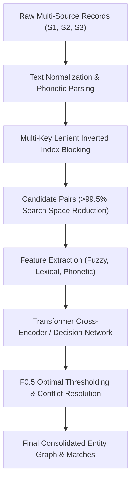

# Multi-Source Business Entity Resolution (ER) System

[](https://www.python.org/)
[](https://pytorch.org/)
[](https://huggingface.co/)
[](https://aws.amazon.com/sagemaker/)
[](LICENSE)

An end-to-end, high-performance Machine Learning pipeline for multi-source **Business Entity Resolution (Record Linkage / Deduplication)** across noisy commercial datasets. 

This system links disparate entity records across independent sources without shared universal keys, resolving severe noise in business names, legal suffixes, abbreviations, landmark-based addresses, and multilingual variations across international jurisdictions (US, India, France).

---

## 📌 Architecture & System Overview

The entity resolution system follows a scalable **Two-Stage Pipeline (Candidate Blocking + Neural Cross-Encoder Reranking)** to balance computational feasibility with matching precision.



### 1. Robust Preprocessing & Normalization
- **Address & Name Normalization**: Handles regional nuances (e.g., postal codes, Indian municipal naming formats, landmark markers like *'Opposite SBI'*, and European formats).
- **Phonetic Encoding**: Double-Metaphone and Soundex encoding tuned for transliterated and misspelled business names.
- **Legal Entity Standardization**: Strips and standardizes corporate entity suffixes (`Pvt Ltd`, `LLC`, `Corp`, `Inc`, `SA`, `GmbH`, `LLP`).

### 2. Multi-Key Lenient Blocking (Candidate Generation)
- High-recall inverted indices over normalized n-grams, phonetic keys, and localized postal tokens.
- Generates high-confidence candidate pairs while pruning over 99.5% of the quadratic Cartesian product space.
- Low-memory streaming pair generators capable of scaling to millions of comparisons without memory bottlenecks.

### 3. Neural Matching & Cross-Encoder Reranking
- **Cross-Encoder Architecture**: Joint token-level self-attention across name-address pairs (`[CLS] S1 [SEP] Candidate [SEP]`) capturing deep semantic alignment.
- **Hybrid Feature Concatenation**: Combines dense neural representations with fine-grained string similarities (Token Sort Ratio, Partial Ratio, Levenshtein, Jaccard).
- **Alternative Architectures Explored**: Tested GLiNER token decision heads with LoRA adaptation and Causal LM rerankers.

### 4. Distributed Cloud Scale (AWS SageMaker)
- Native containerization and launch scripts for AWS SageMaker distributed GPU training (100k, 500k, and 1.5M balanced pairs).
- Optimized batch inference runners supporting multi-GPU sharding on multi-million record datasets.

---

## 📁 Repository Structure

```
.
├── code/
│   └── business_entity_resolution/
│       ├── requirements-train.txt         # Training dependencies
│       ├── sagemaker_job/                 # AWS SageMaker training & inference scripts
│       │   ├── sm_entry.py                # SageMaker training entrypoint
│       │   ├── infer_entry.py             # SageMaker batch inference entrypoint
│       │   ├── requirements.txt           # Container runtime dependencies
│       │   └── requirements-infer.txt     # Inference container dependencies
│       └── src/
│           ├── normalize.py               # Text & address normalization
│           ├── phonetic.py                # Phonetic soundex/metaphone algorithms
│           ├── fuzzy.py                   # String fuzzy similarity metrics
│           ├── metrics.py                 # Macro F0.5 and classification metrics
│           ├── blocking.py                # Inverted index blocking engine
│           ├── lenient_blocking.py        # High-recall relaxed blocking rules
│           ├── build_labeled_pairs.py     # Training pair dataset generator
│           ├── build_labeled_pairs_lowmem.py # Low-memory streaming pair builder
│           ├── sample_balanced_pairs.py   # Balanced positive/negative pair sampler
│           ├── train_cross_encoder.py     # Cross-Encoder fine-tuning pipeline
│           ├── train_cross_encoder_fuzzy.py # Cross-Encoder + tabular fuzzy feature model
│           ├── eval_cross_encoder.py      # Cross-Encoder model evaluation
│           ├── gliner_decide.py           # GLiNER LoRA decision head experiments
│           ├── eval_clm.py                # Causal LM reranker evaluation
│           ├── run_pipeline_sample.py     # End-to-end sample pipeline runner
│           ├── build_model_report.py      # Diagnostic reporting & visualization
│           └── make_submission.py         # Final matching generation & export
├── colab/                                 # Google Colab notebooks & LoRA fine-tuning
├── utils/
│   └── validate_submission.py             # Schema & integrity validation script
├── output/
│   └── matching_results.tsv               # Final predicted entity match output
├── Documentation_template.md              # System design & methodology documentation
└── README.md
```

---

## 📊 Evaluation Metric: Macro $F_{0.5}$

In production entity resolution, **false merges (false positives) are substantially more damaging** than missed links (false negatives), as incorrectly merging distinct corporate entities corrupts downstream operational and compliance graphs.

The system is evaluated and threshold-tuned against the **Macro $F_{0.5}$ score** (weighting precision $2\times$ over recall):

$$F_{0.5} = \frac{1.25 \times \text{Precision} \times \text{Recall}}{0.25 \times \text{Precision} + \text{Recall}}$$

- Computed as an unweighted macro-average across all reference entities.
- Singletons (entities with zero valid matches across other sources) are scored with $1.0$ when correctly identified with an empty match list, penalizing spurious links.

---

## 🚀 Getting Started

### 1. Installation

Clone the repository and install the required dependencies:

```bash
git clone https://github.com/nakshjoshi/Business-Entity-Resolution.git
cd Business-Entity-Resolution

python3 -m venv .venv
source .venv/bin/activate
pip install -r code/business_entity_resolution/requirements-train.txt
```

### 2. Candidate Blocking & Dataset Generation

Generate candidate pairs and build balanced training datasets:

```bash
# Generate candidate pairs via multi-key blocking
python3 code/business_entity_resolution/src/blocking.py \
    --source1 dataset/train/train_source1.tsv \
    --source2 dataset/train/train_source2.tsv \
    --source3 dataset/train/train_source3.tsv \
    --output work/candidates.tsv

# Build balanced training dataset (positives + hard negatives)
python3 code/business_entity_resolution/src/sample_balanced_pairs.py \
    --candidates work/candidates.tsv \
    --ground-truth dataset/train/train_ground_truth.tsv \
    --output work/train_pairs_balanced.tsv
```

### 3. Model Training

Train the Cross-Encoder model locally or on GPU:

```bash
python3 code/business_entity_resolution/src/train_cross_encoder_fuzzy.py \
    --train-pairs work/train_pairs_balanced.tsv \
    --model-name "microsoft/deberta-v3-small" \
    --epochs 3 \
    --batch-size 32 \
    --output-dir models/cross_encoder_v1/
```

### 4. End-to-End Inference & Validation

Run inference over test sets and export validated predictions:

```bash
# Generate matched entities with optimal thresholding
python3 code/business_entity_resolution/src/make_submission.py \
    --candidates work/test_candidates.tsv \
    --scores work/test_scores.tsv \
    --threshold 0.72 \
    --output output/matching_results.tsv

# Validate formatting and constraints
python3 utils/validate_submission.py \
    --matching output/matching_results.tsv \
    --test-dir dataset/test/
```

---

## 📈 Diagnostic & Performance Visualizations

The pipeline includes built-in diagnostic tools (`build_model_report.py`) generating comprehensive visual analysis:
- **Score Distribution Graphs**: Separation between positive matches and hard negative candidates.
- **Threshold vs. $F_{0.5}$ / Precision / Recall Curves**: Data-driven selection of optimal decision boundaries.
- **Precision-Recall Trade-off Curves**: Macro and micro evaluation across individual entity types.
- **Confusion Matrices**: Detailed error analysis across multi-country distributions.

---

## 🛠 Tech Stack

- **Core ML / NLP**: PyTorch, Hugging Face Transformers, Sentence-Transformers, GLiNER, PEFT (LoRA)
- **String & Phonetic Matching**: RapidFuzz, Jellyfish, Metaphone, Double-Metaphone
- **Data Engineering**: Pandas, NumPy, Scikit-learn
- **Cloud & Distributed Computing**: AWS SageMaker, S3, Google Colab Pro
